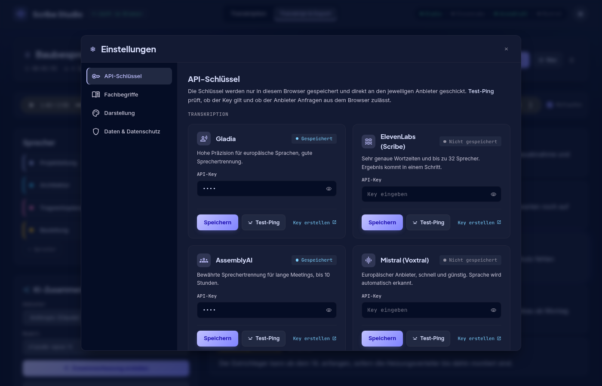
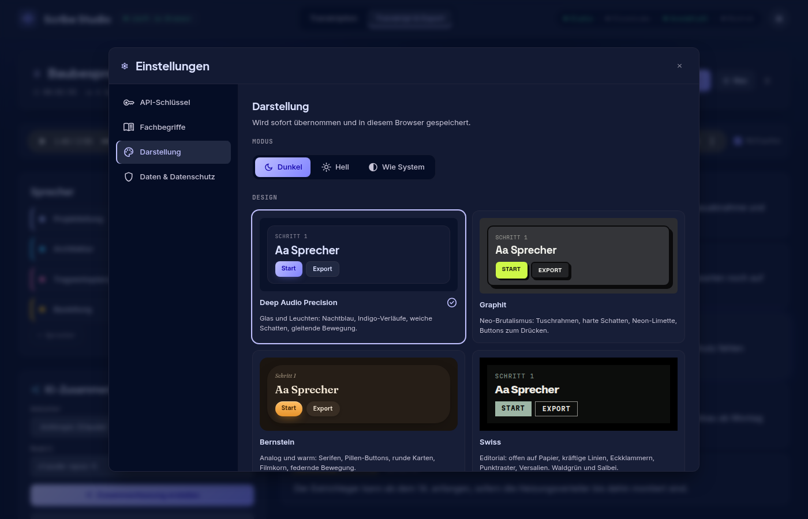
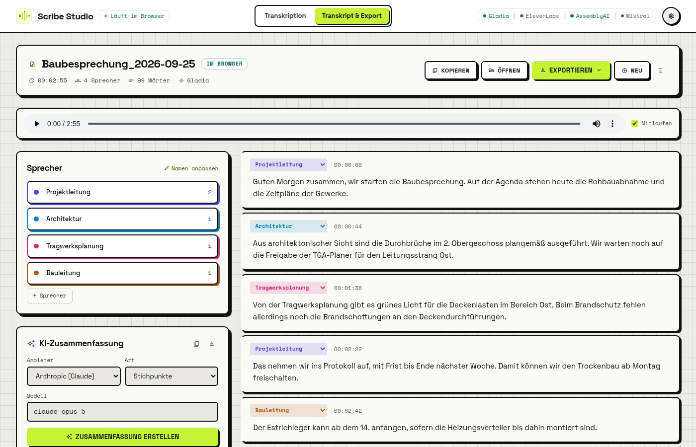
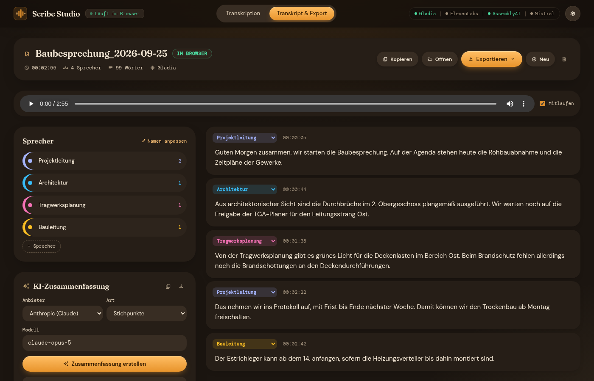
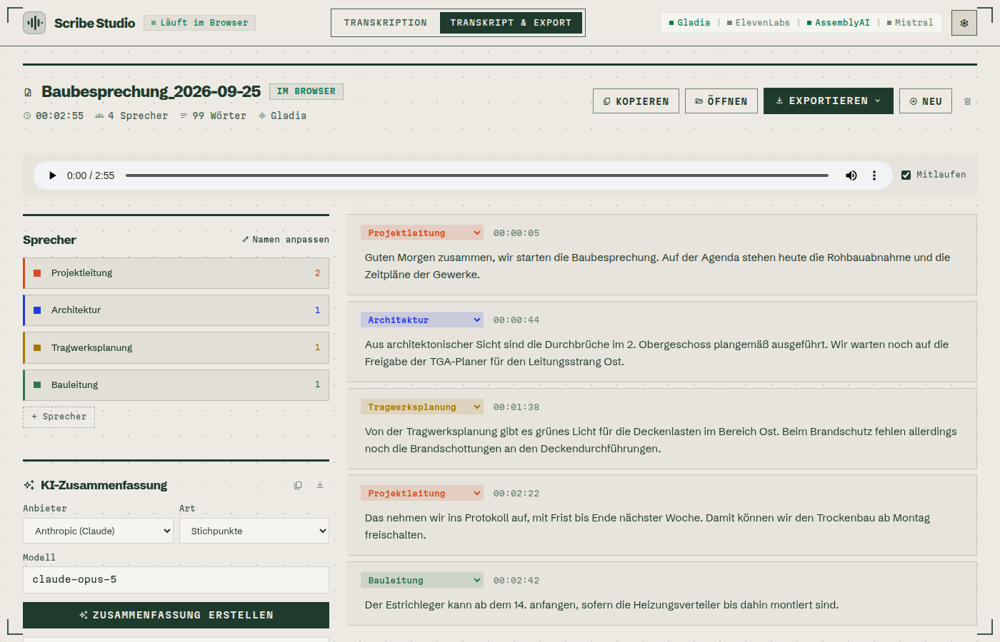
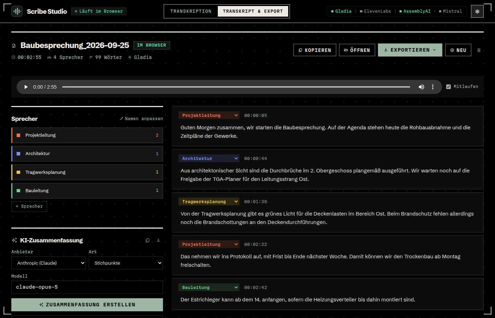
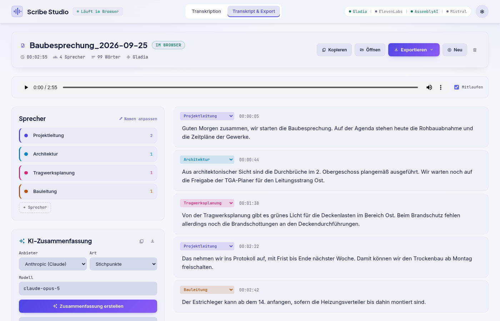
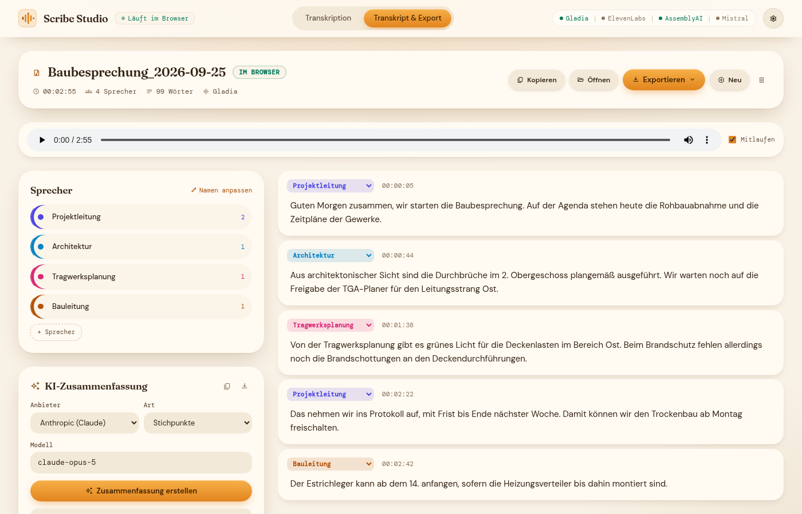
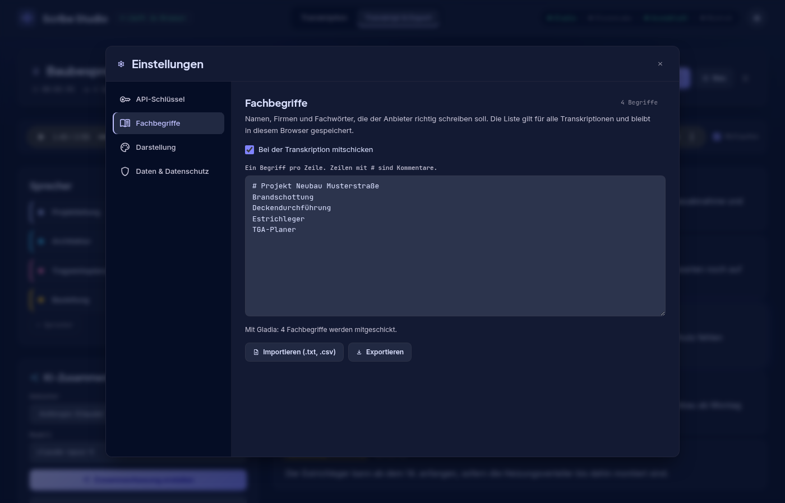

# Scribe Studio

Audioaufnahmen aufnehmen, transkribieren und bearbeiten – komplett im Browser, ohne Installation und ohne eigenen Server. Du bringst deine eigenen API-Schlüssel mit (BYOK: *Bring Your Own Key*), die Audiodatei geht direkt vom Browser zum gewählten Anbieter.


## Auf einen Blick

- **Läuft einfach so:** `index.html` per Doppelklick öffnen – kein Node.js, kein Server, keine Installation. Ideal für Dienstrechner.
- **Vier Anbieter:** Gladia, ElevenLabs (Scribe), AssemblyAI und Mistral (Voxtral), jeweils mit Sprechererkennung.
- **Aufnehmen im Browser:** Mikrofonaufnahme mit Pause, Pegelanzeige und Absturzsicherung.
- **Fachbegriffe:** eine Liste mit Namen und Fachwörtern, die in passender Form an jeden Anbieter geht.
- **Segment-Editor:** Sprecher umbenennen und zuordnen, Text korrigieren, Abschnitte zusammenführen, mitlaufender Player.
- **Export:** HTML-Seite (mit Audio, als PDF druckbar), Markdown, Text, SRT/VTT und Projektdatei zum Weiterbearbeiten.
- **KI-Zusammenfassung:** Stichpunkte, Zusammenfassung oder Protokoll mit Aufgaben über Anthropic (Claude) oder OpenAI.
- **Vier Designs** in Hell und Dunkel, jedes ein eigenes Designsystem.
- **Datenschutz:** Keys, Transkript und Einstellungen bleiben in deinem Browser und lassen sich dort jederzeit löschen.

## Schnellstart

1. Repository herunterladen (*Code → Download ZIP*), entpacken und `index.html` im Browser öffnen.
2. Beim ersten Start öffnen sich die Einstellungen. Unter **API-Schlüssel** mindestens einen Key eintragen und mit **Test-Ping** prüfen – der zeigt auch, ob der Anbieter Anfragen direkt aus dem Browser zulässt.
3. Unter **Transkription** den Anbieter wählen, aufnehmen oder eine Datei ablegen, Modell, Sprache und Sprechererkennung einstellen und **Transkription starten**.
4. Unter **Transkript & Export** korrigieren, Sprecher benennen, zusammenfassen lassen und exportieren.


## Einstellungen

Das Zahnrad ⚙️ oben rechts öffnet ein Fenster mit allen dauerhaften Einstellungen. Alles wird nur in diesem Browser gespeichert.

- **API-Schlüssel:** Keys für die Transkriptions-Anbieter und die KI-Zusammenfassung, jeweils mit **Test-Ping** und Link zum Erstellen eines Keys.
- **Fachbegriffe:** die Begriffsliste mit Import und Export (siehe unten).
- **Darstellung:** Dunkel, Hell oder wie im Betriebssystem eingestellt, dazu die Wahl des Designs (siehe unten).
- **Daten & Datenschutz:** Keys, das zuletzt bearbeitete Transkript und die Sicherung einer unterbrochenen Aufnahme einzeln löschen oder alles zurücksetzen.



## Designs

Jedes Design ist ein eigenes Designsystem mit eigener Schrift, Farben, Ecken, Rahmen, Schatten, Button-Stil, Effekten und Bewegung – jeweils in Hell und Dunkel. Die Auswahl zeigt eine kleine Live-Vorschau.

| Design | Charakter | Schriften |
|---|---|---|
| **Deep Audio Precision** (Standard) | Tech-Glas aus TranscribeLocal: Nachtblau, Indigo-Verläufe, Leuchten, Milchglas, Glanzeffekt auf dem Start-Button, gleitende Übergänge | Plus Jakarta Sans, Inter, JetBrains Mono |
| **Graphit** | Neo-Brutalismus: 2-px-Tuschrahmen, harte versetzte Schatten, Neon-Limette, Karopapier; Buttons drücken sich beim Klick ein | Space Grotesk, Space Mono |
| **Bernstein** | Analog und warm: Serifen, kursive Beschriftungen, Pillen-Buttons, runde Karten ohne Rahmen, weiche warme Schatten, Filmkorn, federnde Bewegung | Fraunces, DM Sans, DM Mono |
| **Swiss** | Editorial nach dem Swiss-Stil (Palette „Bone & forest“) aus dem Skill `code-motion-video`: Inhalt offen auf Papier unter kräftigen Linien, Eckklammern am Bildrand, feines Punktraster und Korn, Versalien, schnelle Wischer. Hell Papier und Waldgrün, dunkel Schwarz und Salbei; Sprecherfarben beginnen mit Persimmon | Schibsted Grotesk, Martian Mono |



<table>
  <tr>
    <td><br><sub>Graphit · hell</sub></td>
    <td><br><sub>Bernstein · dunkel</sub></td>
  </tr>
  <tr>
    <td><br><sub>Swiss · hell</sub></td>
    <td><br><sub>Swiss · dunkel</sub></td>
  </tr>
  <tr>
    <td><br><sub>Deep Audio Precision · hell</sub></td>
    <td><br><sub>Bernstein · hell</sub></td>
  </tr>
</table>

## Mikrofonaufnahme

Mit **Aufnehmen** in der Audio-Karte nimmst du Diktate oder Besprechungen direkt im Browser auf – mit Pause/Weiter, Zeitanzeige und Pegelanzeige. Während der Aufnahme bleibt der Bildschirm an (wo der Browser das erlaubt). Nach **Stopp** wird die Aufnahme wie eine hochgeladene Datei behandelt: Sie liegt im Player und kann transkribiert oder über **Sichern** als Audiodatei gespeichert werden.

- Format: Opus/WebM (Chrome, Edge, Firefox) bzw. AAC/M4A (Safari), ca. 0,5 MB pro Minute.
- Der Browser fragt beim ersten Mal nach der Mikrofon-Freigabe.
- **Absturzsicher:** Während der Aufnahme wird jede Sekunde im Browser (IndexedDB) gesichert. Wird der Tab geschlossen, neu geladen oder vom Handy beendet, bietet Scribe Studio beim nächsten Öffnen an, die unterbrochene Aufnahme wiederherzustellen. Nach einem normalen Stopp wird die Sicherung gelöscht.
- Beim Schließen des Tabs warnt der Browser, solange eine Aufnahme läuft oder eine fertige Aufnahme weder transkribiert noch gesichert wurde.
- Im privaten Modus mancher Browser ist keine Sicherung möglich; die App weist beim Start der Aufnahme darauf hin.

## Grenzen der Anbieter

Vor dem Upload prüft Scribe Studio Dateigröße und Länge gegen die Grenzen des gewählten Anbieters und schlägt passende Alternativen vor – so schlägt nichts erst nach einem langen Upload fehl.

| Anbieter | Max. Dateigröße | Max. Länge |
|---|---|---|
| Gladia | 1.000 MB | 2:15 h (Enterprise: 4:15 h) |
| ElevenLabs | 3 GB | 10 h |
| AssemblyAI | 2,2 GB | 10 h |
| Mistral | keine Vorabprüfung | keine Vorabprüfung |

Besprechungen von 1–2 Stunden (typisch 40–60 MB) passen bei allen Anbietern.

## Fachbegriffe

In den Einstellungen (⚙️) unter **Fachbegriffe** pflegst du eine Liste mit Namen, Firmen, Fachwörtern und Abkürzungen (ein Begriff pro Zeile, Zeilen mit `#` sind Kommentare). Die Liste bleibt im Browser gespeichert, lässt sich als `.txt` exportieren und aus `.txt`/`.csv` importieren. Bei jeder Transkription wird sie im jeweils passenden Format mitgeschickt:

| Anbieter | Parameter | Grenzen |
|---|---|---|
| Gladia | `custom_vocabulary_config` | – |
| ElevenLabs | `keyterms` (nur Scribe v2) | max. 100 Begriffe à 50 Zeichen, ca. 30 % Aufpreis |
| AssemblyAI | `keyterms_prompt` (Universal-3.5 Pro), `word_boost` (Universal-2) | max. 1.000 Begriffe à 6 Wörter |
| Mistral | `context_bias` | max. 100 Begriffe (für Deutsch laut Mistral noch experimentell) |

Auf der Startseite steht, wie viele Begriffe beim gewählten Anbieter ankommen und welche wegen der Grenzen übersprungen werden.



## Segment-Editor

Das Transkript besteht aus Abschnitten (Segmenten) mit Sprecher, Zeitstempel und Text. Viele Anbieter – besonders Gladia – liefern sehr kleine Bruchstücke („Ja,“ / „gut.“). Scribe Studio fasst direkt aufeinanderfolgende Bruchstücke desselben Sprechers automatisch zu Absätzen zusammen (Pause ≤ 2 s, Absatz ≤ 60 s); der Text bleibt dabei vollständig erhalten.

- **Sprecher umbenennen:** In der Sprecherleiste links z. B. „Sprecher A“ in „Projektleitung“ ändern – alle Abschnitte dieses Sprechers ändern sich sofort mit. Über **+ Sprecher** kommt ein weiterer hinzu.
- **Sprecher zuordnen:** Pro Abschnitt über das Auswahlfeld einen anderen Sprecher wählen.
- **Text korrigieren:** Direkt im Abschnitt tippen.
- **Zusammenführen / Löschen:** Über die Symbole rechts im Abschnitt.
- **Click-to-Jump:** Klick auf den Zeitstempel springt im Player an diese Stelle. Der gerade gesprochene Abschnitt wird hervorgehoben, **Mitlaufen** scrollt automatisch mit.
- **Automatisch gespeichert:** Das bearbeitete Transkript bleibt nach einem Neuladen der Seite erhalten. Die Audiodatei selbst wird nicht gespeichert und muss für den Player erneut geladen werden.
- **Auch lange Aufnahmen:** Eine echte Besprechung mit 348 Abschnitten öffnet und rendert in etwa einer Viertelsekunde.

Alle Exporte und die KI-Zusammenfassung verwenden den bearbeiteten Stand.

## Export

Über **Exportieren** über dem Transkript:

| Format | Wofür |
|---|---|
| **HTML-Seite** | Eigenständige Datei zum Lesen und Weitergeben. Optional mit eingebettetem Audio: Klick auf einen Zeitstempel spielt die Stelle ab. Im Browser über *Drucken → Als PDF speichern* sauber druckbar. |
| **Markdown** | Für Obsidian, Notion oder Wikis – mit Frontmatter (Titel, Datum, Quelle, Anbieter, Dauer, Sprecher, Tags). |
| **Text** | `[Projektleitung - 00:01:12]: Guten Morgen …` – zum Einfügen in E-Mail oder Word. |
| **Untertitel SRT / VTT** | Für Videos; VTT enthält die Sprechernamen. |
| **Projektdatei** (`.scribe.json`) | Speichert Transkript, Sprechernamen und Zusammenfassung. Über **Öffnen** später wieder laden und weiterbearbeiten. Die Audiodatei selbst ist nicht enthalten. |

Die KI-Zusammenfassung wird in HTML, Markdown und Projektdatei mit exportiert (abschaltbar im Menü). Beim HTML-Export mit eingebettetem Audio wird die Datei etwa ein Drittel größer als das Audio; ab 25 MB Audio ist das Einbetten deshalb standardmäßig aus.


## Anbieter & Modelle

| Anbieter | Modelle | Ablauf |
|---|---|---|
| Gladia (v2) | `solaria-3` (DE/EN/FR/ES/IT, feste Sprache nötig), `solaria-1` (100+ Sprachen) | Upload → `/v2/pre-recorded` → Polling |
| ElevenLabs (Scribe) | `scribe_v2`, `scribe_v1` | Synchroner Upload an `/v1/speech-to-text` |
| AssemblyAI (v2) | `universal-3-5-pro`, `universal-2` | Upload → `/v2/transcript` → Polling |
| Mistral (Voxtral) | `voxtral-mini-latest` | Synchroner Upload an `/v1/audio/transcriptions` mit Sprechertrennung und Segment-Zeitstempeln (Sprache wird automatisch erkannt) |

Sprechererkennung (Diarization) ist bei allen Anbietern aktivierbar.

### KI-Zusammenfassung

| Anbieter | Modelle (frei änderbar) | Hinweis |
|---|---|---|
| Anthropic | `claude-opus-5`, `claude-sonnet-5`, `claude-haiku-4-5` | Direktzugriff aus dem Browser über den Header `anthropic-dangerous-direct-browser-access` |
| OpenAI | `gpt-5`, `gpt-5-mini` | Chat Completions API |

Zusammengefasst wird immer der aktuelle (ggf. von dir korrigierte) Text im Ergebnisfeld.

## Handy und Tablet

Die Oberfläche passt sich an schmale Bildschirme an: Navigation und Einstellungen rutschen untereinander, das Transkript steht oben.


## Datenschutz

- Es gibt keinen Server von Scribe Studio. Audio und Keys gehen nur an den Anbieter, den du auswählst.
- API-Keys, das zuletzt bearbeitete Transkript, Fachbegriffe und Einstellungen liegen im `localStorage` dieses Browsers; die Sicherung einer laufenden Aufnahme liegt in IndexedDB.
- Alles lässt sich unter ⚙️ → **Daten & Datenschutz** einzeln löschen oder komplett zurücksetzen.
- API-Keys im Browser sind nur für den eigenen, privaten Gebrauch gedacht – die Seite nicht mit eingetragenen Keys öffentlich hosten.

## Projektstruktur

```
index.html              Layout
css/themes.css          Design-Tokens: Standardwerte und gemeinsame Farben je Hell/Dunkel
css/designs/*.css       Je Design eine Datei: Farben, Schrift, Ecken, Schatten, Buttons, Effekte, Bewegung
css/styles.css          Komponenten-Styles (Karten, Felder, Segment-Editor, Einstellungsfenster)
css/tailwind.css        Erzeugte Tailwind-Klassen (npm run build:css)
js/state.js             Zentraler State: Segmente, Sprecher, Rohdaten, Autosave
js/segment-editor.js    Darstellung und Bearbeitung der Segmente, Player-Sync
js/export.js            HTML, Markdown, TXT, SRT, VTT und Projektdatei aus dem bearbeiteten Stand
js/vocabulary.js        Fachbegriffsliste: Pflege, Speicherung, Import/Export, Anbieter-Grenzen
js/recorder.js          Mikrofonaufnahme (MediaRecorder), Pegel, Pause, Bildschirm-wach-halten
js/recording-backup.js  Laufende Sicherung der Aufnahme in IndexedDB, Wiederherstellung
js/summary.js           KI-Zusammenfassung (Anthropic / OpenAI)
js/appearance.js        Hell/Dunkel und Design, wird vor dem ersten Zeichnen gesetzt
js/settings.js          Einstellungsfenster: Kategorien, Darstellung, Daten löschen
js/app.js               Keys, Konfiguration, Datei-Upload, Ablauf der Transkription
js/apis/common.js       Gemeinsame HTTP- und Polling-Helfer
js/apis/*.js            Je ein Modul pro Anbieter (Gladia, ElevenLabs, AssemblyAI, Mistral)
docs/screenshots/       Bilder für diese README
```

Die Skripte werden bewusst als klassische `<script defer>`-Dateien geladen und nicht als ES-Module: Browser blockieren ES-Module, wenn eine Seite per Doppelklick (`file://`) geöffnet wird. Die Module teilen sich das globale Objekt `window.Scribe`. Ein neuer Anbieter wird als Datei unter `js/apis/` angelegt, registriert sich in `Scribe.apis` und in `index.html` eingebunden.

## Design anpassen

Das Aussehen steckt in vier Dateien:

- `css/themes.css` – alle Design-Tokens mit Standardwerten: Schriften, Ecken (`--r-panel`, `--r-btn` …), Rahmen (`--bw`), Schatten (`--shadow-panel`, `--shadow-btn` …), Button-Stil (`--btn-bg`, `--btn-case` …), Unschärfe und Bewegung (`--ease`, `--dur`, `--page-anim`)
- `css/designs/*.css` – je Design eine Datei, die diese Tokens überschreibt, die Farben für Dunkel und Hell festlegt und eigene Effekte ergänzt (Hintergründe, Filmkorn, Eckklammern)
- `tailwind.config.js` – verbindet die Tailwind-Farben (`bg-primary`, `text-on-surface` …) mit den Farb-Variablen
- `css/styles.css` – Bausteine wie Panels, Buttons, Anbieter- und Key-Karten, Segmente, Rekorder, Exportmenü, Einstellungsfenster; sie lesen nur Tokens
- `index.html` – Aufbau der Ansichten mit Tailwind-Klassen

**Neues Design anlegen:** eine Datei in `css/designs/` kopieren (z. B. `graphit.css`), alle `graphit` durch den neuen Namen ersetzen und die Werte ändern (Farben als `R G B`). Tokens stehen auf `[data-theme="…"]`, seitenweite Effekte auf `html[data-theme="…"]`. Dann die Datei in `index.html` verlinken und in `js/appearance.js` einen Eintrag in `THEMES` ergänzen (mit den Google-Fonts-Familien) – das Design erscheint automatisch unter Einstellungen → Darstellung. Neu erzeugt werden muss dafür nichts.

Die JavaScript-Dateien greifen über Element-IDs (z. B. `start-btn`, `segment-list`, `vocab-text`) und die Klassennamen aus `styles.css` auf die Seite zu. Solange diese erhalten bleiben, lassen sich Layout, Farben und Schriften frei ändern.

## Tailwind-CSS neu erzeugen

Die Tailwind-Klassen liegen fertig erzeugt in `css/tailwind.css` – die App braucht dafür kein Skript aus dem Internet. Nur wer im HTML oder JS **neue Tailwind-Klassen** verwendet, muss die Datei neu erzeugen (Node.js nötig):

```
npm install
npm run build:css
```

## Hinweise

- Schriften und Symbole (Material Symbols) kommen von Google Fonts; die Schriften eines Designs werden erst geladen, wenn es gewählt oder in den Einstellungen angezeigt wird. Ohne Internet greifen Standardschriften, und Symbole erscheinen als Wörter.
- Schlägt eine Anfrage mit „Netzwerk- oder CORS-Fehler“ fehl, blockiert der Anbieter direkte Browser-Anfragen. Der **Test-Ping** in den Einstellungen zeigt das vorab.

## Ausblick

- **Etappe 2:** Fortschrittsanzeige während der Transkription, Player mit Wellenform, Suche im Transkript, Verteilung der Redezeit auf die Sprecher.
- **Etappe 3:** Verlauf/Archiv früherer Transkripte im Browser und Kennzahlen.
