# Unisono

Audio und Video transkribieren, lesen, korrigieren und exportieren, komplett im Browser, ohne Installation und ohne eigenen Server. Du bringst deine eigenen API-Keys mit (BYOK: *Bring Your Own Key*), die Datei geht direkt vom Browser zur gewählten Engine.

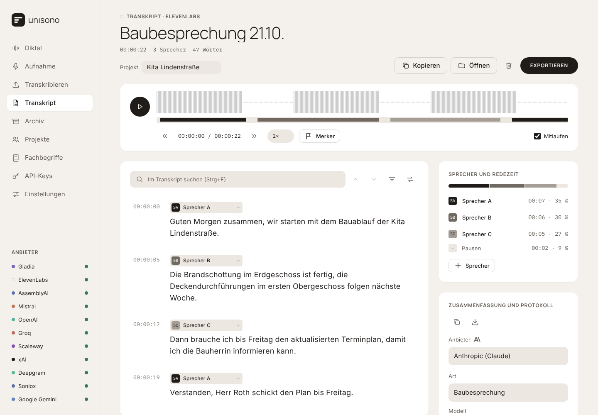

**Live ansehen:** https://unisono-app-seven.vercel.app/

## Auf einen Blick

- **Läuft einfach so:** `index.html` per Doppelklick öffnen. Kein Node.js, kein Server, keine Installation, keine Verbindung zu Google Fonts. Ideal für Dienstrechner.
- **Viele Engines:** Gladia, ElevenLabs (Scribe), AssemblyAI und Mistral (Voxtral) mit Sprechererkennung, dazu OpenAI, Groq, Deepgram, Soniox, Gemini, xAI u. a. ohne Sprechertrennung. Zur Auswahl stehen nur Engines, für die ein Key hinterlegt ist.
- **Diktat:** sprechen, die KI räumt den Text auf (Stile wie Aufräumen, E-Mail oder Aktenvermerk), er liegt sofort in der Zwischenablage. Mit schwebendem Fenster, Umformulieren, Langdiktat, Ersetzungsregeln, Verlauf und Statistik.
- **Aufnehmen im Browser:** Mikrofonaufnahme mit Pause, Pegelanzeige und Absturzsicherung.
- **Fachbegriffe:** eine Liste mit Namen und Fachwörtern, die in passender Form an jede Engine geht.
- **Live-Fortschritt:** Hochladen mit echtem Prozentwert und Tempo, Verarbeitungszeit, jederzeit abbrechbar.
- **Player:** einfarbige Wellenform, darunter die Sprecherspur. Klicken oder ziehen zum Springen.
- **Redezeit:** ein geteilter Balken plus Minuten und Prozent je Sprecher, dazu die Pausen.
- **Suchen und Ersetzen:** Treffer markiert im Text, nur Treffer anzeigen, einzeln oder alle ersetzen.
- **Segment-Editor:** Sprecher umbenennen und zuordnen, Text korrigieren, Abschnitte zusammenführen, mitlaufender Player.
- **Export:** HTML-Seite (mit Audio, als PDF druckbar), Markdown, Text, SRT/VTT und Projektdatei zum Weiterbearbeiten.
- **Zusammenfassung:** Stichpunkte, Zusammenfassung oder Protokoll mit Aufgaben über Anthropic (Claude) oder OpenAI.
- **Hell und Dunkel,** fest oder wie im Betriebssystem eingestellt.
- **Datenschutz:** Keys, Transkript und Einstellungen bleiben in deinem Browser und lassen sich dort jederzeit löschen.

## Schnellstart

1. Repository herunterladen (*Code → Download ZIP*), entpacken und `index.html` im Browser öffnen.
2. Beim ersten Start öffnet sich **API-Keys**. Mindestens einen Key eintragen und mit **Prüfen** testen. Das zeigt auch, ob der Anbieter Anfragen direkt aus dem Browser zulässt.
3. Unter **Transkribieren** eine Datei ablegen (oder unter **Aufnahme** live aufnehmen), die Engine wählen (unter **Optionen** Modell, Sprache und Sprecher) und **Mit … transkribieren**.
4. Unter **Transkript** korrigieren, Sprecher benennen, zusammenfassen lassen und exportieren.

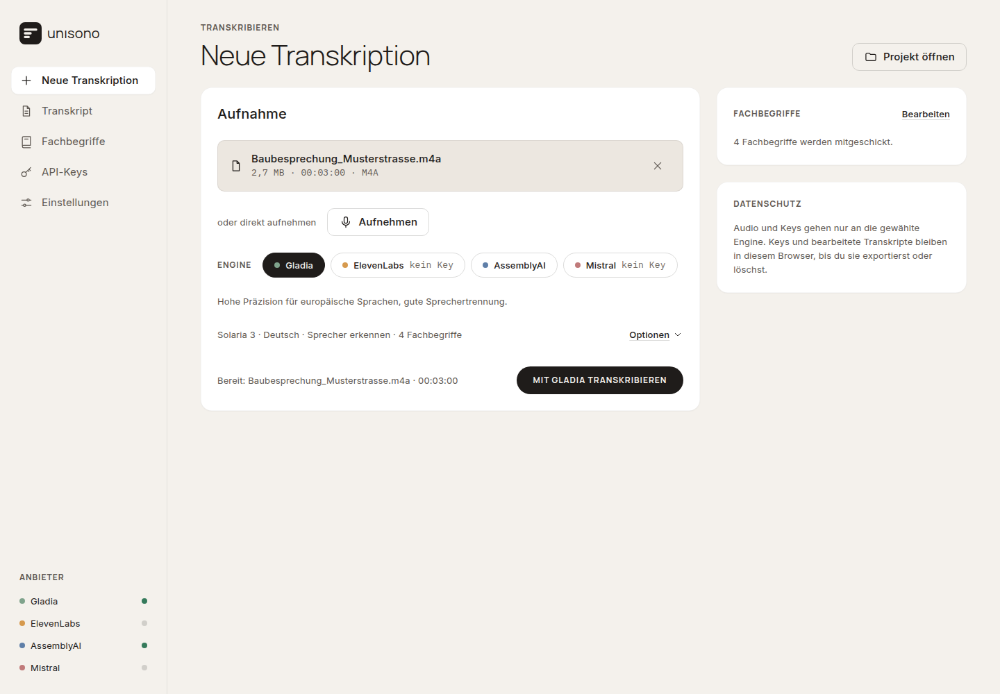

## Aufbau

Links steht die Seitenleiste. Auf dem Handy gibt es unten eine Tab-Leiste mit Datei, Transkript, Aufnahme, Begriffe und Mehr; die API-Keys erreicht man dort über die Engine-Punkte oben rechts.

| Seite | Inhalt |
|---|---|
| **Diktat** | Sprechen, aufräumen lassen, kopieren; Umformulieren; schwebendes Fenster; Stile, Verlauf, Statistik, Einstellungen. Siehe „Diktat“. |
| **Aufnahme** | Live aufnehmen (vor Ort, Diktat) mit Merkern; danach „Transkribieren“ oder „Aufnahme sichern“. Auf Handy und Tablet die Startseite. Mit eingeschaltetem Modul auch die Meeting-Aufnahme. |
| **Transkribieren** | Vorhandene Audio- oder Videodatei ablegen, Engine wählen, Optionen, Start. Während des Laufs der Fortschritt. |
| **Transkript** | Player, Transkript-Editor, Suche, Sprecher und Redezeit, Projekt, Zusammenfassung und Protokoll-Vorlagen, Aufgaben, Export. |
| **Archiv** | Alle Transkripte mit Suche und Kennzahlen; Dateien, die ohne Netz warten. Siehe „Archiv“. |
| **Projekte** | Projekte mit den Personen, die immer wieder vorkommen. Siehe „Projekte, Protokolle und Aufgaben“. |
| **Fachbegriffe** | Begriffsliste mit Import und Export, dazu Ersetzungsregeln für das Diktat. |
| **API-Keys** | Keys aller Anbieter, jeweils mit **Prüfen**, **Entfernen** und der Anleitung „So bekommst du einen Key“. Filter wie in der Android-App: Transkription, Umformulierung, Echtzeit, EU. |
| **Einstellungen** | Darstellung (Hell, Dunkel, Wie System), zusätzliche Module (Meeting-Aufnahme) sowie Daten und Datenschutz: Keys, Transkript, Archiv, Projekte, Aufnahme-Sicherung, Diktat-Verlauf und Diktat-Statistik einzeln löschen oder alles zurücksetzen. |

Unten in der Seitenleiste stehen die Engines mit hinterlegtem Key. Auf den Seiten „Transkribieren“, „Diktat“ und bei der Zusammenfassung zeigen die Auswahllisten nur Anbieter mit Key; ein neu gespeicherter Key erscheint sofort.

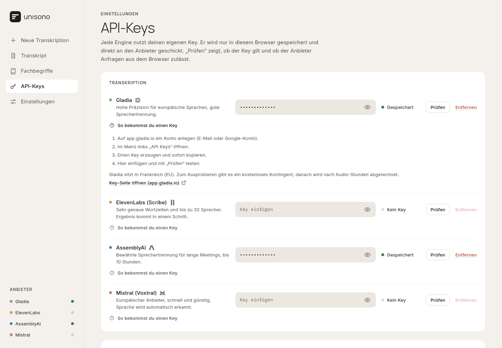

## Fortschritt während der Transkription

Nach dem Start zeigt Unisono die Schritte *Vorbereiten → Hochladen → Verarbeiten → Fertig*:

- **Hochladen** mit echtem Prozentwert, übertragenen MB, Tempo und geschätzter Restzeit – bei 50-MB-Besprechungen sieht man, dass es vorangeht.
- **Verarbeiten** mit der Zeit, die der Anbieter schon rechnet.
- **Abbrechen** stoppt Upload oder Warten sofort. Was schon beim Anbieter liegt, löscht er nach seinen eigenen Regeln.
- Solange eine Transkription läuft, warnt der Browser vor dem Schließen des Tabs.

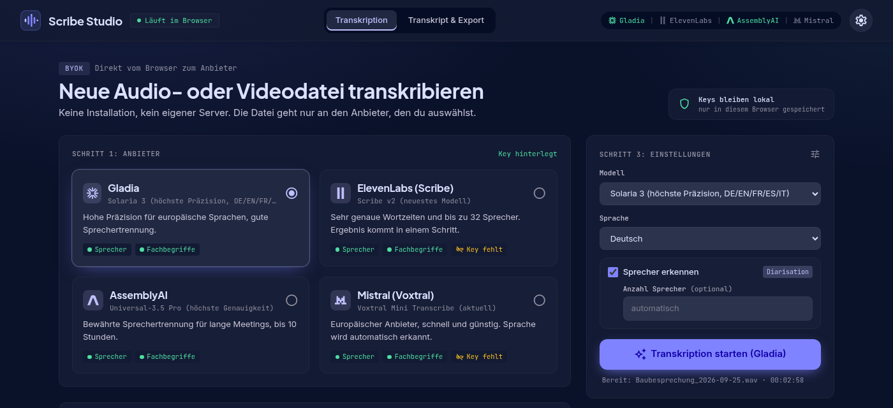

## Player, Sprecherspur und Redezeit

- **Wellenform:** einfarbig, der gespielte Teil dunkler. Darunter die **Sprecherspur**: ein Balken je Redeabschnitt in der Graustufe des Sprechers. Die Abspielposition läuft als Linie durch beide. Klicken oder ziehen springt an die Stelle, beim Überfahren stehen Zeit, Kürzel und Sprecher; mit dem Fokus auf der Zeitleiste springen ← / → um 5 Sekunden.
- **Bedienung:** Abspielen/Pause, 10 Sekunden zurück/vor, Geschwindigkeit 0,75× bis 2×, **Mitlaufen** scrollt zum gerade gesprochenen Abschnitt.
- **Ohne Audiodatei** (etwa nach dem Neuladen oder beim Öffnen einer Projektdatei) bleibt die Sprecherspur; ein Klick springt zum passenden Abschnitt im Text.
- **Sprecher:** Jeder Sprecher hat ein Kürzel aus zwei Buchstaben (z. B. „Bauleitung LBB“ → BL), das in Spur, Transkript und Redezeit gleich erscheint. Die vier Graustufen wiederholen sich ab dem fünften Sprecher, dann unterscheiden die Kürzel. Farbe steht in Unisono nur für eine Engine oder einen Status.
- **Redezeit:** ein geteilter Balken, darunter je Sprecher Minuten und Prozent, dazu die **Pausen**. Das zeigt, wer die Besprechung geprägt hat – und verrät, wenn die Erkennung eine Person in zwei Sprecher aufgeteilt hat (ein „Sprecher“ mit 1 %).
- **Wellenform auch bei langen Aufnahmen:** WAV wird blockweise gelesen, MP3 stückweise dekodiert (2:40 h WAV in etwa 1 s, 70 min MP3 in etwa 4 s). M4A, WebM und OGG müssten Browser komplett in den Speicher dekodieren; dort gibt es die Wellenform bis 20 Minuten, bei längeren Dateien die Sprecherspur.

## Suchen & Ersetzen

Über dem Transkript (oder mit **Strg+F** bzw. **⌘F**):

- Treffer werden direkt im Text markiert, **Enter** / **Umschalt+Enter** springt zum nächsten / vorigen.
- **Nur Treffer** blendet alle anderen Abschnitte aus.
- **Ersetzen** ändert den aktuellen Treffer, **Alle ersetzen** alle – praktisch, wenn der Anbieter einen Namen immer gleich falsch schreibt. Groß- und Kleinschreibung spielt beim Suchen keine Rolle.

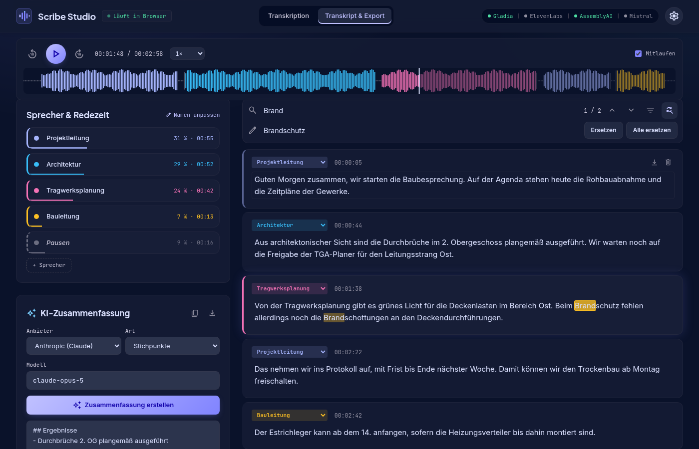

## Mikrofonaufnahme

Auf der Seite **Aufnahme** nimmst du Diktate oder Besprechungen direkt im Browser auf – mit Pause/Weiter, Zeitanzeige und Pegelanzeige. Ein roter Punkt zeigt die laufende Aufnahme. Während der Aufnahme bleibt der Bildschirm an (wo der Browser das erlaubt). Nach **Stopp** wird die Aufnahme wie eine hochgeladene Datei behandelt: Sie liegt im Player und kann über **Transkribieren** weiterverarbeitet oder über **Aufnahme sichern** als Audiodatei gespeichert werden. Während einer Aufnahme zeigt ein roter Punkt an „Aufnahme“ in der Navigation, dass sie läuft, auch wenn man auf einer anderen Seite ist.

- Format: Opus/WebM (Chrome, Edge, Firefox) bzw. AAC/M4A (Safari), ca. 0,5 MB pro Minute.
- Der Browser fragt beim ersten Mal nach der Mikrofon-Freigabe.
- **Absturzsicher:** Während der Aufnahme wird jede Sekunde im Browser (IndexedDB) gesichert. Wird der Tab geschlossen, neu geladen oder vom Handy beendet, bietet Unisono beim nächsten Öffnen an, die unterbrochene Aufnahme wiederherzustellen. Nach einem normalen Stopp wird die Sicherung gelöscht.
- Beim Schließen des Tabs warnt der Browser, solange eine Aufnahme läuft oder eine fertige Aufnahme weder transkribiert noch gesichert wurde.
- Im privaten Modus mancher Browser ist keine Sicherung möglich; die App weist beim Start der Aufnahme darauf hin.

### Vor-Ort-Termine mit dem Handy

- **Die Seite „Aufnahme“ ist die Vor-Ort-Ansicht:** große Zeit, Pegel, darunter im Daumenbereich der große Button **Merker setzen**, darunter **Pause** und **Stopp**. **Bildschirm abdunkeln** schaltet auf einen fast schwarzen Bildschirm (spart Akku, blendet nicht); Tippen hellt wieder auf. Am PC gibt es zusätzlich eine Großansicht (Symbol oben rechts in der Karte).
- **Nach dem Stopp** steht die Karte **Letzte Aufnahme** oben, mit **Transkribieren** als nächstem Schritt und **Aufnahme sichern**.
- **Merker:** Ein Tipp setzt eine Zeitmarke, z. B. für einen Mangel oder eine Entscheidung. Nach der Transkription stehen die Merker in einer Liste (umbenennen, springen, entfernen), als Zeilen im Transkript und als Fahnen in der Wellenform. Weitere Merker lassen sich später beim Abhören über **Merker** im Player setzen. Sie landen in Projektdatei, HTML, Markdown und Text.
- **Bildschirm nicht sperren:** Handy-Browser schalten das Mikrofon ab, sobald der Bildschirm gesperrt oder die App gewechselt wird. Unisono hält den Bildschirm während der Aufnahme wach und weist darauf hin.
- **Unterbrechungen:** Passiert es doch, bleibt das Bisherige gesichert. Beim Zurückkehren nimmt Unisono in **dieselbe Datei** weiter auf (oder bietet **Weiter aufnehmen** an, wenn der Browser das Mikrofon nur nach einem Tipp freigibt). Die Lücke wird als Merker „Unterbrechung (… ohne Ton)“ vermerkt; Zeitanzeige und Merker bleiben dabei deckungsgleich mit der Audiodatei.

## Diktat

Auf der Seite **Diktat** sprichst du, die KI räumt den Text auf, und er liegt in der Zwischenablage. Dann mit **Strg+V** (am Mac **⌘V**) in jedes Programm einfügen. Das ist die Browser-Fassung der Android-App „diktat“.

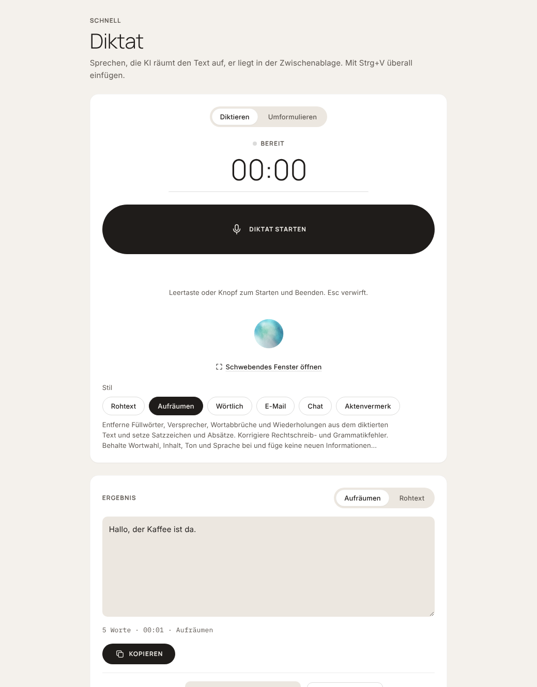

**Ablauf:** aufnehmen → mit der gewählten Engine transkribieren (ohne Sprechertrennung, mit deinen Fachbegriffen) → mit dem gewählten **Stil** von einer KI deiner Wahl aufräumen → **Ersetzungen** anwenden → anzeigen, kopieren, im Verlauf merken.

- **Bedienung:** *Antippen* (Knopf oder Leertaste startet und beendet) oder *Halten* (Knopf oder Leertaste gedrückt halten, solange du sprichst). **Esc** verwirft. Die Leertaste gilt, solange die Seite „Diktat“ oder das schwebende Fenster den Fokus hat und kein Textfeld. Ein roter Punkt an „Diktat“ zeigt, dass eine Aufnahme läuft.
- **Stile:** *Rohtext* (nur das Transkript), *Aufräumen*, *Wörtlich*, *E-Mail*, *Chat* und *Aktenvermerk*, mit demselben Wortlaut wie in der Android-App. Unter **Stile verwalten** legst du eigene Stile an (Name und Anweisung), bearbeitest oder löschst sie; die eingebauten dienen als Vorlage für Kopien.
- **Ergebnis:** bei Aufräumen lässt sich zwischen aufgeräumtem Text und **Rohtext** umschalten, der Text ist direkt bearbeitbar. **Neu aufräumen** wendet einen anderen Stil auf dasselbe Diktat an, ohne neu zu sprechen.
- **Zwischenablage:** Das Ergebnis wird sofort kopiert (abschaltbar). Blockiert der Browser das, bleibt der Knopf **Kopieren**.
- **Ersetzungen:** Unter **Fachbegriffe** stehen feste Regeln „aus → in“ (ganzes Wort oder Teilstück, mit oder ohne Groß/Klein), die nach der KI auf den fertigen Text und auf den Rohtext laufen, von oben nach unten. Leeres Ziel löscht das Wort. Die Fachbegriffe selbst gehen als Hinweis an die Engine und zusätzlich an die KI, damit Namen wie gelistet geschrieben werden.
- **Verlauf:** die letzten 50 Diktate (Zeit, Stil, Text) mit Kopieren, Anzeigen und Löschen; löschbar unter **Einstellungen → Daten und Datenschutz**.
- **Einstellungen der Seite:** Engine (Standard: ElevenLabs, wenn ein Key da ist, sonst die erste Engine mit Key), Modell, Sprache, KI-Anbieter und -Modell (Standard Claude Haiku 5.5, schnell und günstig), automatisch kopieren, Langdiktat. ElevenLabs und Mistral antworten in einem Schritt, Gladia und AssemblyAI brauchen einige Sekunden länger.

- **Mehr Anbieter für das Diktat:** Für die Spracherkennung zusätzlich OpenAI, Groq, Together AI, Scaleway, OVHcloud, SiliconFlow, OpenRouter, xAI (Grok), Deepgram, Soniox, Google Gemini und AssemblyAI Sync (die Ein-Anfrage-Variante von AssemblyAI, gleicher Key wie AssemblyAI). Zum Aufräumen die KI von Anthropic, OpenAI, Groq, Google Gemini, Mistral, OpenRouter, Together AI, DeepInfra, xAI, DeepSeek, Cerebras, SiliconFlow, Scaleway oder OVHcloud. Wer einen Anbieter schon für die Spracherkennung eingetragen hat, nutzt denselben Key zum Aufräumen. Modelle und Adressen sind dieselben wie in der Android-App; bei Anbietern ohne feste Modellliste lädt Unisono die Liste des Anbieters, sobald ein Key da ist. Diese Engines gibt es auch für Dateien; dort ist „Sprecher erkennen“ für sie abgeschaltet, und die Grenzen des Anbieters (Größe, Länge) werden vor dem Upload geprüft.
- **Auch dabei:** Microsoft Azure, Ollama und eigene Server, siehe „Region, Endpunkt und eigene Server“. **Nicht dabei** sind die Offline-Modelle auf dem Gerät. Ob Cerebras und Scaleway Anfragen aus dem Browser zulassen, ließ sich ohne Key nicht prüfen; **Prüfen** unter „API-Keys“ zeigt es.
- **Falls die KI ausfällt** (Key fehlt, Netzwerk): Das Rohtext-Ergebnis steht trotzdem bereit, mit dem Grund in der Meldung.

### Live mitschreiben (Echtzeit)

Mit **ElevenLabs**, **Deepgram** oder **Mistral** als Engine gibt es unter „Einstellungen“ der Seite den Schalter **Live mitschreiben**. Dann geht das Mikrofon schon beim Sprechen an den Anbieter, und der Text erscheint unter dem Aufnahmeknopf und im schwebenden Fenster, während du redest. Beim Stopp ist der Rohtext sofort fertig; Aufräumen, Ersetzungen, Verlauf und Kopieren laufen wie gewohnt.

- **Modelle:** Mistral *Voxtral Mini Transcribe Realtime* (`voxtral-mini-transcribe-realtime-2602`, Standard) und das neue `voxtral-mini-transcribe-realtime-3-0` (Modell-ID von Mistrals Voxtral-3-Seite; mit einem Key noch nicht ausprobiert). Mistral erkennt die Sprache selbst und nimmt bei Echtzeit keine Fachbegriffe an. ElevenLabs *Scribe v2 Realtime*; Deepgram *Nova-3* (mit „Automatisch erkennen“ folgt es mehreren Sprachen), *Nova-2* und *Flux* (erkennt Sprechpausen). Bei Deepgram gilt die EU-Region aus „API-Keys“ auch live. Fachbegriffe gehen bei Nova-3 als Schlüsselbegriffe mit.
- **Ausfall:** Unisono nimmt nebenher wie immer auf. Bricht die Live-Verbindung ab oder kommt kein Text, wird die Aufnahme nach dem Stopp mit dem Modell aus „Modell“ transkribiert. Die Meldung nennt den Grund.
- **Anmeldung:** Ein Browser kann bei Live-Verbindungen keinen Key im Header mitschicken. Deepgram nimmt ihn deshalb, wie für Browser dokumentiert, im Protokoll-Feld der Verbindung entgegen. Für ElevenLabs und Mistral holt Unisono mit dem Key zuerst ein kurzlebiges Token (bei Mistral `POST /v1/client/sessions`, etwa 15 Minuten gültig, an das Modell gebunden) und öffnet die Verbindung nur damit; bei Mistral geht es als Subprotokoll `realtime` mit. Die Nachrichten (`session.update`, `input_audio.append`, `input_audio.flush`, `input_audio.end`, `transcription.text.delta`, `transcription.done`) sind die des offiziellen Python-SDKs von Mistral.
- Das Audio geht als 16-kHz-PCM in Häppchen von etwa 0,1 Sekunden. Langdiktat ist bei „Live“ nicht nötig und ruht.
- Beim Umformulieren und auf der Seite „Aufnahme“ wird nicht live mitgeschrieben.

### Schwebendes Fenster

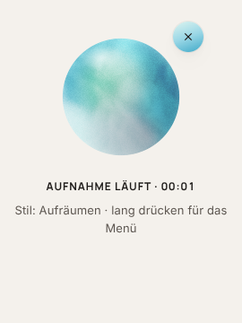

**Schwebendes Fenster öffnen** (unter dem Aufnahmeknopf) setzt ein kleines Fenster über alle anderen Programme. Es sieht aus und funktioniert wie der schwebende Button der Android-App: eine Kugel (**Wolke** in fünf Farben oder **Welle**), die beim Sprechen auf die Lautstärke reagiert, beim Verarbeiten einen Spinner zeigt und danach kurz ein Häkchen oder Kreuz. Ein rundes Kreuz daneben verwirft die Aufnahme, ein **langer Druck** auf die Kugel öffnet das Menü (Diktieren oder Umformulieren, Stil bzw. Anweisung), und nach ein paar Sekunden ohne Nutzung wird die Kugel kleiner und durchsichtiger. Aussehen, Farbe und Verkleinern stellst du unter „Einstellungen“ der Seite Diktat ein; eine Vorschau der Kugel steht unter dem Aufnahmeknopf. Das Ergebnis erscheint darunter mit **Kopieren**. So diktierst du, während ein anderes Programm den Fokus hat: In das Programm klicken, im schwebenden Fenster aufnehmen, danach im Programm mit Strg+V einfügen. Das Ergebnis wird aus dem schwebenden Fenster heraus kopiert, weil der Browser dem Tab dahinter das Kopieren verbietet, solange er nicht den Fokus hat.

- Gibt es in **Chrome und Edge ab Version 116** („Document Picture-in-Picture“). Firefox und Safari kennen es nicht; dort steht an der Stelle ein Hinweis und das Diktat bleibt in diesem Tab.
- Die Leertaste, Esc und der Knopf wirken im schwebenden Fenster wie auf der Seite. Der Tab „Unisono“ muss offen bleiben, er macht die Arbeit (Aufnahme, Transkription, KI).
- Ein Tastenkürzel, das auch bei einem anderen aktiven Programm greift, kann eine Webseite nicht anbieten; dafür wäre eine Browser-Erweiterung nötig.

### Umformulieren

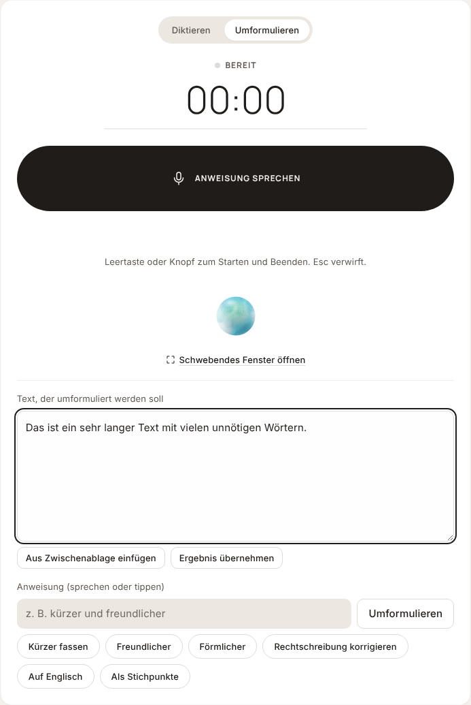

Oben auf der Seite von **Diktieren** auf **Umformulieren** umschalten. Dann gibt es ein Feld für den **Text** (einfügen, tippen, **Aus Zwischenablage einfügen** oder **Ergebnis übernehmen** für die nächste Runde) und eine **Anweisung**, die du sprichst („mach das kürzer und freundlicher“) oder tippst. Fertige Vorschläge (*Kürzer fassen*, *Freundlicher*, *Förmlicher*, *Rechtschreibung korrigieren*, *Auf Englisch*, *Als Stichpunkte*) führen sich mit einem Klick aus.

- Die KI wendet nur die Anweisung an und lässt Inhalt, Namen, Zahlen und Sprache sonst stehen. Deine Fachbegriffe und Ersetzungen gelten auch hier.
- Das Ergebnis lässt sich auf **Vorher** zurückschalten und landet mit der Anweisung im Verlauf. Es wird wie beim Diktat kopiert.
- Es braucht den Key des KI-Anbieters; ein Rohtext-Ersatz wie beim Diktat gibt es hier nicht.

### Langdiktat

Bei **Antippen** teilt Unisono eine lange Aufnahme an Sprechpausen in Teile (mindestens 20 Sekunden und eine Pause von etwa einer Sekunde; ein Teil wird nie länger als etwa 90 Sekunden) und transkribiert jedes Teil schon, während du weiterredest. Beim Stopp ist der Text fast sofort da, und die KI räumt den ganzen Text in **einem** Durchgang auf. Die Anzeige nennt, wie viele Teile schon transkribiert sind. Ein fehlgeschlagener Teil wird einmal wiederholt. Bei **Halten** und beim Umformulieren wird nicht geteilt; unter „Einstellungen“ der Seite lässt sich das Langdiktat abschalten.

### Statistik

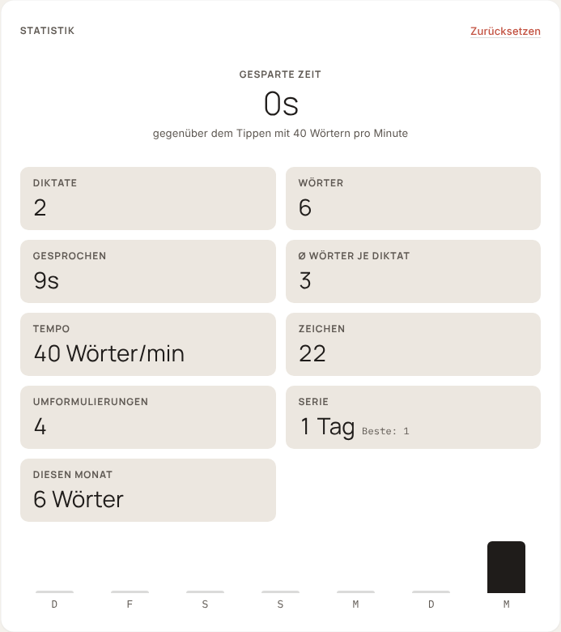

Die Karte **Statistik** zählt wie die Android-App: Diktate, Wörter, Zeichen, gesprochene Zeit, Wörter je Diktat, Tempo (Wörter pro Minute), KI-Durchgänge (Aufräumen und Umformulieren), die Serie aufeinanderfolgender Tage, die Wörter dieses Monats und ein Balkendiagramm der letzten sieben Tage. **Gesparte Zeit** vergleicht mit dem Tippen von 40 Wörtern pro Minute. Alles bleibt im Browser; zurücksetzen geht in der Karte oder unter **Einstellungen → Daten und Datenschutz**.

## Archiv

- **Automatisch:** Jedes Transkript – frisch transkribiert, aus einer Projektdatei geöffnet oder aus dem Archiv – liegt im Archiv dieses Browsers und wird beim Bearbeiten mitgespeichert (Text, Sprechernamen, Merker, Zusammenfassung). Das Audio wird nur bei Aufnahmen aus der Warteschlange mitgespeichert, sonst wie bei Projektdateien nicht.
- **Seite „Archiv“:** Liste mit Datum, Länge, Sprechern, Wörtern und Engine, Suche in Titel, Text und Sprechernamen, Öffnen und Löschen. Öffnen ersetzt das offene Transkript; das bleibt aber selbst im Archiv.
- **Kennzahlen:** Anzahl der Transkripte, Audio gesamt, Wörter, dieser Monat und die Verteilung nach Engine.
- **Jetzt aufnehmen, später transkribieren:** Ist beim Start keine Verbindung da (oder bricht der Upload deshalb ab), wartet die Datei mit allen Einstellungen im Archiv. Sobald der Browser wieder online ist, wird sie automatisch transkribiert und landet samt Audio im Archiv; „Jetzt versuchen“ startet es von Hand.
- Auf dem Handy erreicht man das Archiv über **Mehr → Archiv → Anzeigen**. Das Archiv liegt in IndexedDB; im privaten Fenster ist es aus.

## Grenzen der Anbieter

Vor dem Upload prüft Unisono Dateigröße und Länge gegen die Grenzen des gewählten Anbieters und schlägt passende Alternativen vor – so schlägt nichts erst nach einem langen Upload fehl.

| Anbieter | Max. Dateigröße | Max. Länge |
|---|---|---|
| Gladia | 1.000 MB | 2:15 h (Enterprise: 4:15 h) |
| ElevenLabs | 3 GB | 10 h |
| AssemblyAI | 2,2 GB | 10 h |
| Mistral | keine Vorabprüfung | keine Vorabprüfung |
| Microsoft Azure | 300 MB | 2 h |

Besprechungen von 1–2 Stunden (typisch 40–60 MB) passen bei allen Anbietern.

## Fachbegriffe

Unter **Fachbegriffe** pflegst du eine Liste mit Namen, Firmen, Fachwörtern und Abkürzungen (ein Begriff pro Zeile, Zeilen mit `#` sind Kommentare). Die Liste bleibt im Browser gespeichert, lässt sich als `.txt` exportieren und aus `.txt`/`.csv` importieren. Bei jeder Transkription wird sie im jeweils passenden Format mitgeschickt:

| Anbieter | Parameter | Grenzen |
|---|---|---|
| Gladia | `custom_vocabulary_config` | – |
| ElevenLabs | `keyterms` (nur Scribe v2) | max. 100 Begriffe à 50 Zeichen, ca. 30 % Aufpreis |
| AssemblyAI | `keyterms_prompt` (Universal-3.5 Pro), `word_boost` (Universal-2) | max. 1.000 Begriffe à 6 Wörter |
| Mistral | `context_bias` | max. 100 Begriffe (für Deutsch laut Mistral noch experimentell) |

Unter „Transkribieren“ steht, wie viele Begriffe bei der gewählten Engine ankommen und welche wegen der Grenzen übersprungen werden. Dieselbe Seite enthält die **Ersetzungen** für das Diktat (siehe „Diktat“).

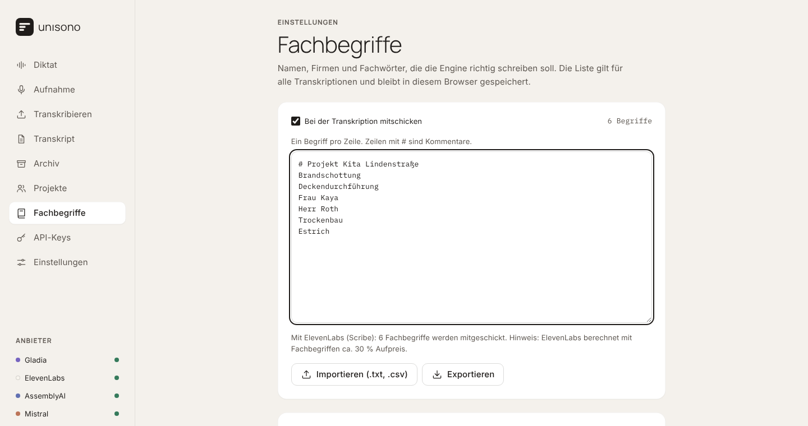

## Segment-Editor

Das Transkript besteht aus Abschnitten (Segmenten) mit Sprecher, Zeitstempel und Text. Viele Anbieter – besonders Gladia – liefern sehr kleine Bruchstücke („Ja,“ / „gut.“). Unisono fasst direkt aufeinanderfolgende Bruchstücke desselben Sprechers automatisch zu Absätzen zusammen (Pause ≤ 2 s, Absatz ≤ 60 s); der Text bleibt dabei vollständig erhalten.

- **Sprecher umbenennen:** Unter „Sprecher und Redezeit“ z. B. „Sprecher A“ in „Projektleitung“ ändern . Alle Abschnitte dieses Sprechers und das Kürzel ändern sich sofort mit. Über **Sprecher** kommt ein weiterer hinzu.
- **Sprecher zuordnen:** Pro Abschnitt auf das Sprecherlabel klicken und einen anderen Sprecher wählen.
- **Text korrigieren:** Direkt im Abschnitt tippen.
- **Zusammenführen / Löschen:** Über die Symbole rechts im Abschnitt (beim Überfahren oder mit dem Fokus sichtbar).
- **Click-to-Jump:** Klick auf den Zeitstempel springt im Player an diese Stelle. Der gerade gesprochene Abschnitt wird hinterlegt und links markiert, **Mitlaufen** scrollt automatisch mit.
- **Automatisch gespeichert:** Das bearbeitete Transkript bleibt nach einem Neuladen der Seite erhalten. Die Audiodatei selbst wird nicht gespeichert und muss für den Player erneut geladen werden.
- **Auch lange Aufnahmen:** Eine echte Besprechung mit 348 Abschnitten öffnet und rendert in etwa einer Viertelsekunde.

Alle Exporte und die KI-Zusammenfassung verwenden den bearbeiteten Stand.

## Export

Über **Exportieren** über dem Transkript:

| Format | Wofür |
|---|---|
| **HTML-Seite** | Eigenständige Datei im Unisono-Stil (hell und dunkel) zum Lesen und Weitergeben. Optional mit eingebettetem Audio: Klick auf einen Zeitstempel spielt die Stelle ab. Im Browser über *Drucken → Als PDF speichern* sauber druckbar. |
| **Markdown** | Für Obsidian, Notion oder Wikis – mit Frontmatter (Titel, Datum, Quelle, Anbieter, Dauer, Sprecher, Tags). |
| **Text** | `[Projektleitung - 00:01:12]: Guten Morgen …` – zum Einfügen in E-Mail oder Word. |
| **Untertitel SRT / VTT** | Für Videos; VTT enthält die Sprechernamen. |
| **Projektdatei** (`.unisono.json`) | Speichert Transkript, Sprechernamen und Zusammenfassung. Über **Öffnen** später wieder laden und weiterbearbeiten. Die Audiodatei selbst ist nicht enthalten. |

Die KI-Zusammenfassung wird in HTML, Markdown und Projektdatei mit exportiert (abschaltbar im Menü). Beim HTML-Export mit eingebettetem Audio wird die Datei etwa ein Drittel größer als das Audio; ab 25 MB Audio ist das Einbetten deshalb standardmäßig aus.

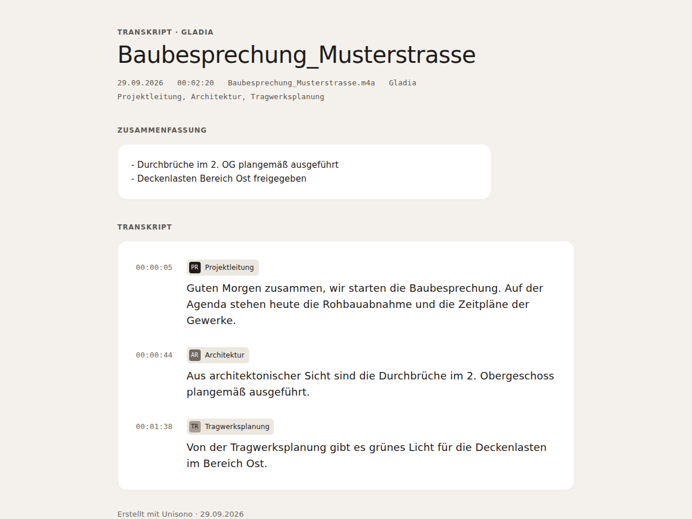

## Anbieter & Modelle

| Anbieter | Modelle | Ablauf |
|---|---|---|
| Gladia (v2) | `solaria-3` (DE/EN/FR/ES/IT, feste Sprache nötig), `solaria-1` (100+ Sprachen) | Upload → `/v2/pre-recorded` → Polling |
| ElevenLabs (Scribe) | `scribe_v2`, `scribe_v1` | Synchroner Upload an `/v1/speech-to-text` |
| AssemblyAI (v2) | `universal-3-5-pro`, `universal-2` | Upload → `/v2/transcript` → Polling |
| Mistral (Voxtral) | `voxtral-mini-latest`, `voxtral-small-transcribe-3-0`, `voxtral-mini-transcribe-3-0` | Synchroner Upload an `/v1/audio/transcriptions` mit Sprechertrennung und Segment-Zeitstempeln (Sprache wird automatisch erkannt) |

Sprechererkennung (Diarization) ist bei diesen Anbietern aktivierbar, außerdem bei OpenAI mit dem Modell `gpt-4o-transcribe-diarize`. Die übrigen Engines liefern Text ohne Sprecher; der Haken ist bei ihnen gesperrt.

### Region, Endpunkt und eigene Server

Manche Anbieter brauchen in ihrer Zeile unter „API-Keys“ mehr als einen Key. Unisono speichert diese Angaben wie die Keys nur in diesem Browser.

| Anbieter | Einstellung | Hinweis |
|---|---|---|
| AssemblyAI | Region Standard oder EU (Dublin) | Gilt auch für AssemblyAI Sync. Derselbe Key. |
| Soniox | Region Standard oder EU | Der Key muss aus einem EU-Projekt der Soniox-Konsole stammen. |
| Deepgram | Region Standard oder EU | Derselbe Key. |
| OpenRouter | Region Standard oder EU | Nur für Firmenkonten (Enterprise); gilt für Spracherkennung und Aufräumen. |
| Microsoft Azure | Endpunkt der eigenen Speech-Ressource | MAI-Transcribe 2 (mit Stil „clean“) und 1.5. MAI läuft nur in East US, West US, West US 2, North Europe, Southeast Asia und Central India; North Europe hält die Daten in der EU. |
| Ollama | Adresse, z. B. `http://localhost:11434/v1/` | Ohne Key. Ollama muss Anfragen von dieser Seite erlauben (Umgebungsvariable `OLLAMA_ORIGINS`). |
| Eigener Server | Adresse und Modell für die Spracherkennung | Jeder Server mit OpenAI-kompatibler Schnittstelle (z. B. Speaches, LocalAI, vLLM), für Spracherkennung und Aufräumen; Key nur, falls der Server einen verlangt. |

Gemini hat zusätzlich das Modell `gemini-3.5-transcribe`. Es läuft über die Interactions-API im Modus „smart“ und lässt Füllwörter und Versprecher weg.

Ein Server auf dem eigenen Rechner muss Anfragen von der Adresse der Seite zulassen (CORS). Chrome fragt außerdem beim ersten Zugriff einer Webseite auf das lokale Netzwerk nach der Erlaubnis. Eine `http://`-Adresse außerhalb von `localhost` blockiert der Browser auf einer `https`-Seite meist; sie würde Key und Audio auch unverschlüsselt schicken.

Jede Engine hat eine feste Farbe (Punkt in Chips, Fortschrittslinie, Seitenleiste): Gladia Salbei, AssemblyAI Fjord, ElevenLabs Bernstein, Mistral Rosenholz. Logos erscheinen nur klein und neutral neben dem Namen unter „API-Keys“. Die Marken gehören ihren Inhabern und kennzeichnen hier nur den jeweiligen Dienst; Quellen stehen in `js/brand-logos.js`.

### Zusammenfassung und Protokoll

Jede KI mit Key unter „API-Keys“ (Anthropic, OpenAI, Gemini, Mistral, Ollama, …) kann zusammenfassen; das Modell ist frei wählbar. Bei Anthropic geht die Anfrage direkt aus dem Browser über den Header `anthropic-dangerous-direct-browser-access`. Verarbeitet wird immer der aktuelle (ggf. von dir korrigierte) Text. Dieselben Keys nutzt das Aufräumen im Diktat.

## Projekte, Protokolle und Aufgaben

- **Projekte und Personen:** Auf der Seite **Projekte** legst du Projekte an und trägst die Personen ein, die immer wieder vorkommen, mit Rolle oder Firma („Frau Kaya, Bauherrin“). Ein Projekt ist das **aktuelle**; neue Transkripte gehören dazu (wählbar auch auf „Transkribieren“ und im Kopf des Transkripts). Die Namen des aktuellen Projekts gehen als Fachbegriffe an die Spracherkennung, auch im Diktat. Beim Benennen der Sprecher und bei Verantwortlichen schlägt Unisono sie vor, dazu „Ich“.
- **Protokoll-Vorlagen:** Unter „Zusammenfassung und Protokoll“ gibt es neben Stichpunkten, Zusammenfassung und Protokoll mit Aufgaben die Vorlagen **Baubesprechung** (nummerierte Punkte, Termine, Aufgabentabelle, Behinderungen und Nachträge), **Begehung** (Feststellungen nach Ort, Mängelliste, nach Merkern geordnet), **Telefonnotiz** und **Aktenvermerk**. Projekt, Datum, die Namen der Sprecher, die Personen des Projekts mit Rolle und die Merker gehen als Kontext mit, damit die KI sie nicht raten muss.
- **Aufgaben:** Die Karte **Aufgaben** sammelt, wer was bis wann tut. **Aufgaben erkennen** liest sie mit der KI aus dem Transkript (Anbieter und Modell wie bei der Zusammenfassung; schon vorhandene kommen nicht doppelt). Jede Aufgabe lässt sich ändern, abhaken, löschen oder von Hand anlegen; eine Frist ist ein Datum oder ein Text wie „nächste Woche“. Kopieren als Tabelle (Markdown) oder Speichern als CSV für Excel.
- Projekt und Aufgaben gehören zum Transkript: Sie stehen im Archiv (mit der Zahl offener Aufgaben, durchsuchbar), in der Projektdatei und im Markdown- und HTML-Export.

## Meeting-Aufnahme (Modul)

Unter **Einstellungen → Zusätzliche Module** lässt sich die **Meeting-Aufnahme** einschalten. Dann gibt es auf der Seite „Aufnahme“ die Karte **Meeting aufnehmen**. Der Code dafür wird erst beim ersten Klick geladen.

- Aufgenommen wird der Ton eines Web-Meetings ohne Bot im Meeting: ein **Browser-Tab** (Teams, Zoom, Meet im Browser, beim Teilen „Tab-Audio teilen“ eingeschaltet lassen) oder unter Windows der **Bildschirm mit Systemton** für die Desktop-App. Dazu kommt dein **Mikrofon**; beides landet gemischt in einer Datei. Am Mac kann der Browser keinen Systemton aufnehmen; dort geht nur ein Tab.
- **Vor dem Start** bestätigst du, dass alle Teilnehmer wissen, dass aufgenommen wird, und einverstanden sind. Das nichtöffentlich gesprochene Wort heimlich aufzunehmen ist strafbar (§ 201 StGB).
- Während der Aufnahme zeigt die Karte die Zeit und die Pegel von Meeting und Mikrofon. „Freigabe beenden“ in der Leiste des Browsers beendet die Aufnahme ebenfalls.
- Danach geht die Datei wie gewohnt auf „Transkribieren“, mit eingeschalteter Sprechertrennung. Unisono hat sich alle 0,2 Sekunden gemerkt, ob dein Mikrofon lauter war als das Meeting. Der Sprecher, der überwiegend in diesen Momenten spricht, heißt nach dem Transkribieren **„Ich“**. Dafür braucht es eine Engine mit Sprechertrennung (Gladia, ElevenLabs, AssemblyAI, Mistral, OpenAI mit `gpt-4o-transcribe-diarize`). Mit Kopfhörern klappt die Trennung am zuverlässigsten.
- Die Meeting-Aufnahme wird nicht laufend gesichert wie die Aufnahme vor Ort; nach dem Stopp lässt sie sich mit **Aufnahme speichern** herunterladen.

## Handy und Tablet

Auf schmalen Bildschirmen ersetzt eine Tab-Leiste unten die Seitenleiste, Karten stehen untereinander.

<table>
  <tr>
    <td>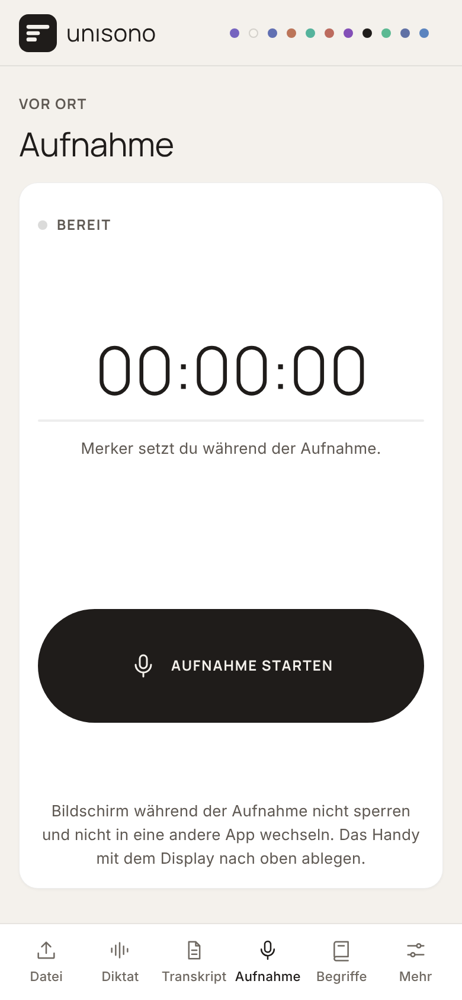</td>
    <td>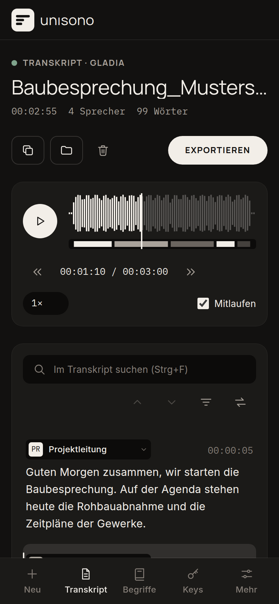</td>
  </tr>
</table>

## Datenschutz

- Es gibt keinen Server von Unisono. Audio und Keys gehen nur an den Anbieter, den du auswählst.
- API-Keys, Anbieter-Einstellungen (Region, Adressen), Projekte mit Personen, das zuletzt bearbeitete Transkript, Fachbegriffe, Ersetzungen, eigene Diktat-Stile, der Diktat-Verlauf, die Diktat-Statistik und Einstellungen liegen im `localStorage` dieses Browsers; die Sicherung einer laufenden Aufnahme sowie Archiv und Warteschlange (Transkripte, bei Warteschlangen-Aufnahmen auch das Audio) liegen in IndexedDB.
- Alles lässt sich unter **Einstellungen → Daten und Datenschutz** einzeln löschen oder komplett zurücksetzen.
- API-Keys im Browser sind nur für den eigenen, privaten Gebrauch gedacht – die Seite nicht mit eingetragenen Keys öffentlich hosten.

## Projektstruktur

```
index.html              Layout: Seitenleiste, Seiten (Views), Icon-Sprite, Tab-Leiste
favicon.svg             Bildmarke als App-Icon
DESIGN.md               Designregeln von Unisono (zuerst lesen)
css/tokens.css          Design-Tokens: Farben, Schrift, Abstände, Radien, Tiefe, Bewegung; Hell und Dunkel
css/app.css             Komponenten, ausschließlich aus den Tokens gebaut
fonts/                  Manrope, Inter, IBM Plex Mono (woff2, SIL Open Font License, siehe fonts/OFL.txt)
js/state.js             Zentraler State: Segmente, Sprecher, Rohdaten, Autosave
js/segment-editor.js    Segmente, Sprecherlabels und Kürzel, Redezeit, Player-Sync
js/markers.js           Merker: Liste, Zeilen im Transkript, Merker im Player setzen
js/player.js            Player-Bedienung, Wellenform und Sprecherspur
js/search.js            Suchen und Ersetzen mit Markierung im Text
js/progress.js          Fortschrittsanzeige mit Upload-Prozent und Abbrechen
js/icons.js             Linien-Icons aus dem Sprite in index.html
js/brand-logos.js       Logos der Anbieter als SVG
js/export.js            HTML, Markdown, TXT, SRT, VTT und Projektdatei aus dem bearbeiteten Stand
js/vocabulary.js        Fachbegriffsliste: Pflege, Speicherung, Import/Export, Anbieter-Grenzen
js/recorder.js          Mikrofonaufnahme, Pegel, Pause, Merker, Großansicht, Weiteraufnahme nach Unterbrechung
js/recording-backup.js  Laufende Sicherung der Aufnahme in IndexedDB, Wiederherstellung
js/summary.js           Zusammenfassung und Protokoll-Vorlagen, `complete()` auch für das Diktat
js/protocol-core.js     Vorlagen, Aufgaben (lesen, Markdown, CSV), „Ich“ bei Meetings – ohne Seite, mit Node-Tests
js/tasks.js             Karte „Aufgaben“ im Transkript
js/people.js            Projekte und Personen, Seite „Projekte“
js/meeting.js           Meeting-Aufnahme (Modul, wird erst bei Bedarf geladen)
js/dictation-core.js    Diktat ohne Seite: Stile, KI-Anweisungen, Ersetzungsregeln, Verlauf, Teilung an Pausen, Statistik (mit Node testbar)
js/dictation.js         Seite „Diktat“: Aufnahme, Langdiktat, Ablauf, Umformulieren, Stile, Verlauf, Statistik, Ersetzungen
js/orbs.js              Kugeln Wolke (WebGL-Shader) und Welle (Canvas) wie im Android-Button
js/dictation-mini.js    Schwebendes Fenster (Document Picture-in-Picture) für das Diktat
js/archive-core.js      Archiv ohne Seite: Einträge, Suche, Kennzahlen (mit Node testbar)
js/archive.js           Archiv und Warteschlange „später transkribieren“ (IndexedDB) mit der Seite „Archiv“
tests/                  `node tests/dictation-core.test.js`, `node tests/archive-core.test.js`
js/appearance.js        Hell, Dunkel oder wie System, wird vor dem ersten Zeichnen gesetzt
js/settings.js          Seite „Einstellungen“: Darstellung, Daten löschen
js/app.js               Seiten, Keys, Engine-Auswahl, Datei-Upload, Ablauf der Transkription
js/apis/common.js       Gemeinsame HTTP-Helfer: Upload mit Fortschritt, Polling, Abbrechen
js/apis/*.js            Je ein Modul pro Engine (Gladia, ElevenLabs, AssemblyAI, Mistral, weitere in dictation-engines.js, KI in llm.js)
js/apis/realtime.js     Live-Transkription: Mikrofon als 16-kHz-PCM über WebSocket (ElevenLabs, Deepgram)
docs/screenshots/       Bilder für diese README
```

Die Skripte werden bewusst als klassische `<script defer>`-Dateien geladen und nicht als ES-Module: Browser blockieren ES-Module, wenn eine Seite per Doppelklick (`file://`) geöffnet wird. Die Module teilen sich das globale Objekt `window.Unisono`. Eine neue Engine wird als Datei unter `js/apis/` angelegt, registriert sich in `Unisono.apis` und wird in `index.html` eingebunden. Ihre Farbe kommt aus `--provider-free` bzw. einem neuen Token in `css/tokens.css` und wird in `css/app.css` unter „Provider colors“ zugeordnet.

## Design anpassen

Grundlage ist das Designsystem in [`DESIGN.md`](DESIGN.md):

- `css/tokens.css` enthält alle Werte. Hell ist Standard, Dunkel greift über die Systemeinstellung oder `data-theme="dark"` am `<html>`.
- `css/app.css` baut die Komponenten nur aus diesen Variablen: keine eigenen Farben, Schatten, Radien oder Schriftgrößen.
- Icons sind eigene Linien-Icons (24er-Raster, Strich 1,5) als `<symbol>` in `index.html`.

Die JavaScript-Dateien greifen über Element-IDs (z. B. `start-btn`, `segment-list`, `vocab-text`) auf die Seite zu. Solange diese erhalten bleiben, lässt sich das Layout frei ändern.

## Hinweise

- Schriften liegen im Ordner `fonts/`, die App lädt nichts von Google oder anderen CDNs.
- Schlägt eine Anfrage mit „Netzwerk- oder CORS-Fehler“ fehl, blockiert der Anbieter direkte Browser-Anfragen. **Prüfen** unter „API-Keys“ zeigt das vorab.
- Umbenennung: Die App hieß früher „Scribe Studio“. Keys und Einstellungen unter dem alten Namen werden nicht übernommen und beim ersten Start entfernt; alte `.scribe.json`-Projekte lassen sich nicht mehr öffnen.

## Ausblick

**Umgesetzt:**
- **Etappe 4a – Vor Ort (mobil),** siehe „Vor-Ort-Termine mit dem Handy“.
- **Diktat im Browser** mit schwebendem Fenster, Umformulieren, Langdiktat, Ersetzungsregeln, Verlauf und Statistik, siehe „Diktat“.
- **Viele Anbieter** für Spracherkennung und Aufräumen, mit Filtern (Transkription, Umformulierung, Echtzeit, EU) auf der Seite „API-Keys“; Auswahllisten zeigen nur Anbieter mit Key.
- **Echtzeit im Diktat:** Live mitschreiben mit ElevenLabs, Deepgram und Mistral, auch im schwebenden Fenster, siehe „Live mitschreiben (Echtzeit)“.
- **Etappe 3:** Archiv mit Suche und Kennzahlen, „jetzt aufnehmen, später transkribieren“, siehe „Archiv“.
- **Etappe 4b:** Meeting-Aufnahme ohne Bot als zuschaltbares Modul, eigenes Mikrofon als „Ich“, siehe „Meeting-Aufnahme (Modul)“.
- **Etappe 5:** Protokoll-Vorlagen, Aufgabenliste mit Verantwortlichen und Fristen, Projekte mit wiederkehrenden Personen, siehe „Projekte, Protokolle und Aufgaben“.
- **Anbieter-Feinschliff:** EU-Region für AssemblyAI, Soniox, Deepgram und OpenRouter, Microsoft Azure (MAI-Transcribe), Ollama und eigene Server, Sprechertrennung bei OpenAI, Gemini im Modus „smart“, siehe „Region, Endpunkt und eigene Server“.

**Als Nächstes:**
- **Echtzeit, weitere Schritte:** live mitschreiben auch auf der Seite „Aufnahme“ (mit Sprechern bei Deepgram) und mit weiteren Anbietern, die es können (Soniox, AssemblyAI, OpenAI, Gemini, xAI, Gladia).
- **Mit echten Keys zu prüfen:** ob Cerebras und Scaleway Anfragen direkt aus dem Browser zulassen („Prüfen“ unter „API-Keys“).
- **Ideen danach:** Meeting-Aufnahme laufend sichern wie die Aufnahme vor Ort; Aufgaben über alle Transkripte eines Projekts hinweg; eigene Protokoll-Vorlagen.
